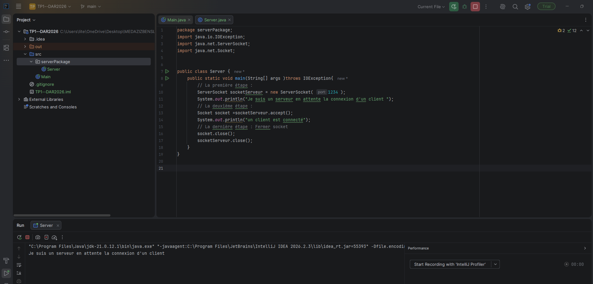
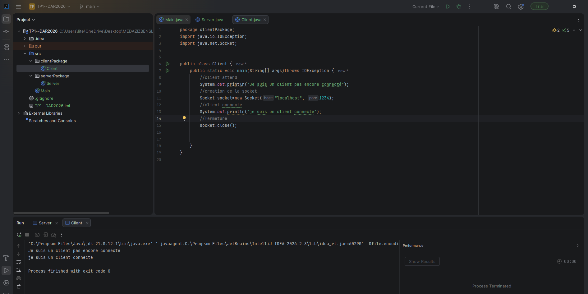
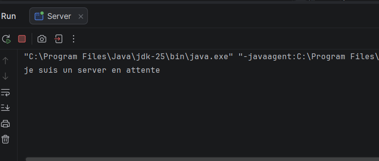
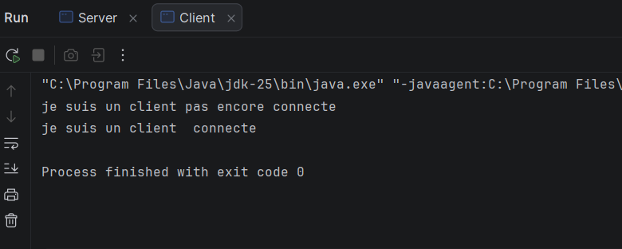
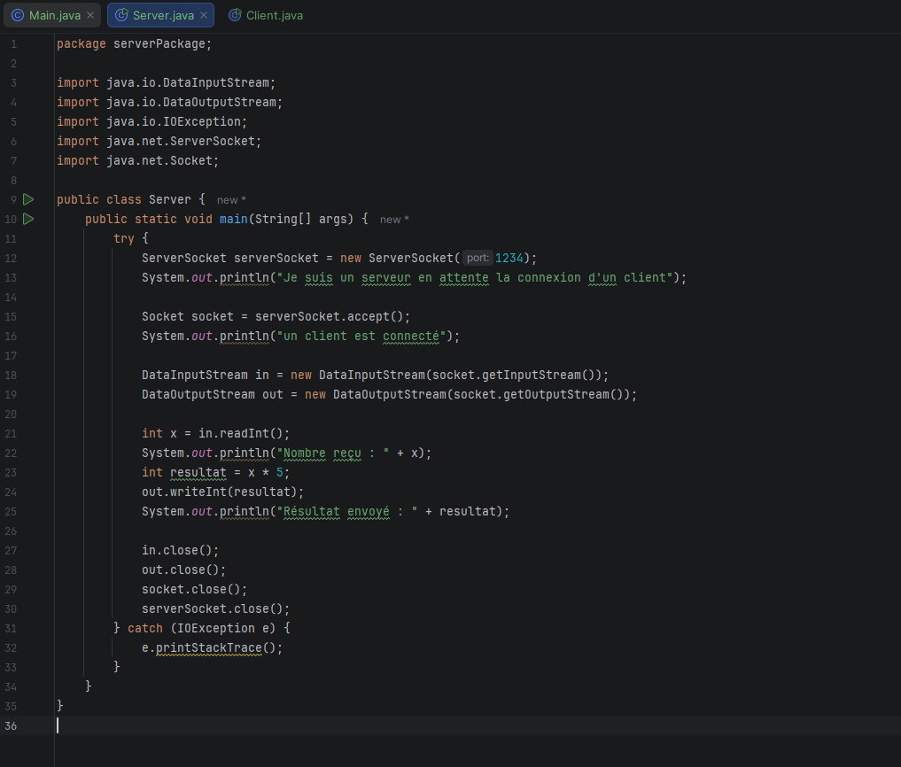
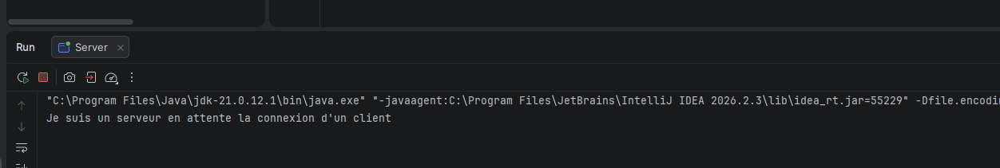
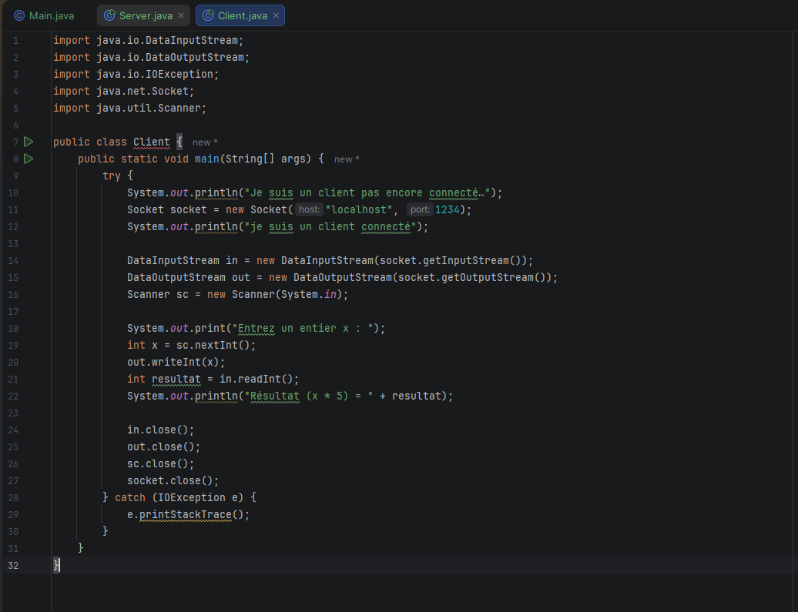
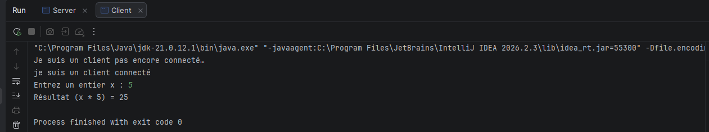

# TP1 — DAR 2026 : Communication Client-Serveur en Java

## 1. Présentation du projet

Établir une communication entre un client et un serveur en Java à l'aide des sockets TCP.

Le serveur attend les connexions entrantes, tandis que le client tente de se connecter au serveur en utilisant une adresse IP et un numéro de port.

## 2. Technologies utilisées

- **Langage :** Java
- **Version :** JDK 21
- **IDE :** IntelliJ IDEA
- **Communication réseau :** Sockets Java

## 3. Structure du projet

- `Server.java` : création et exécution du serveur.
- `Client.java` : création du client et tentative de connexion au serveur.

## 4. Exécution du programme

### Lancement du serveur

Le serveur est exécuté en premier. Il écoute les connexions entrantes sur l'adresse IP et le port configurés dans le programme.

**Capture d'écran :** lancement du serveur.

### Lancement du client

Après le démarrage du serveur, le client est exécuté afin d'établir une connexion avec celui-ci.

**Capture d'écran :** lancement du client.

## 5. Captures d'écran

Les captures d'écran présentant le code source et les résultats d'exécution seront ajoutées dans cette section.

### Code source du serveur

### Code source du client

### Résultat d'exécution du serveur

### Résultat d'exécution du client

## 6. Conclusion

Ce TP permet de comprendre les bases de la communication client-serveur en Java

Activité 1-2 : Service de calculatrice

Objectif
Établir une communication entre un client et un serveur en Java à l'aide des sockets TCP afin de réaliser un calcul côté serveur et de renvoyer le résultat au client.

Application serveur
La classe Server, située dans le package serverPackage, attend la connexion d'un client sur le port 1234.

Après la connexion, le serveur reçoit un nombre entier envoyé par le client à l'aide de DataInputStream. Il multiplie ce nombre par 5, puis renvoie le résultat au client avec DataOutputStream.

Application client
La classe Client, située dans le package ClientPackage, se connecte au serveur à l'aide d'une socket TCP sur localhost et le port 1234.

Le client demande à l'utilisateur de saisir un nombre entier, l'envoie au serveur, puis reçoit et affiche le résultat du calcul effectué par le serveur.
serveur:

Resultat:

CLIENT:

Resultat:

