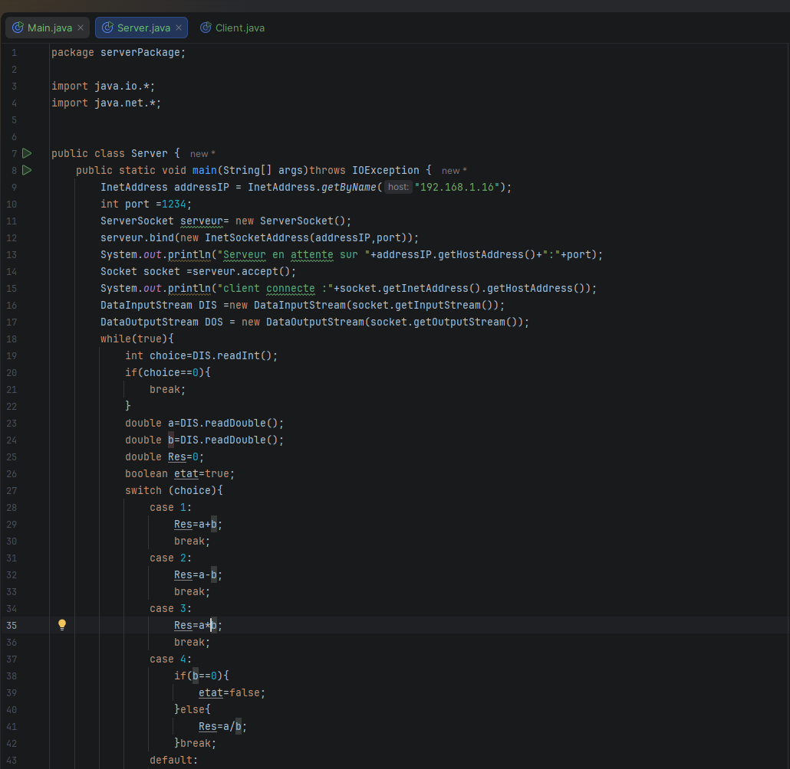
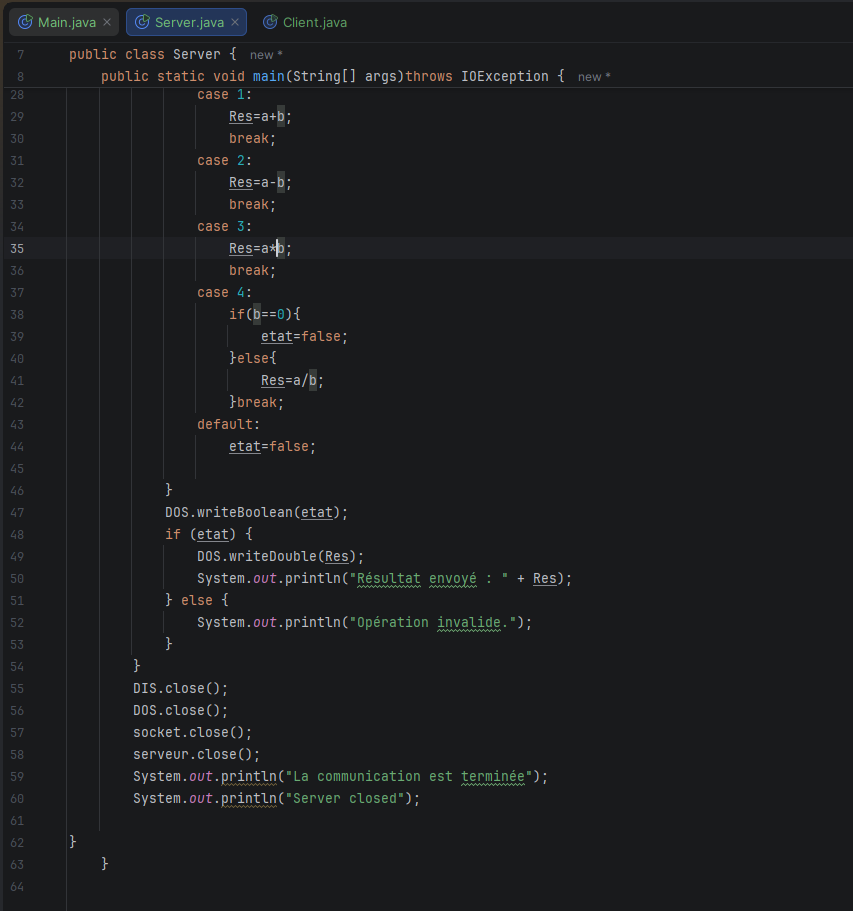
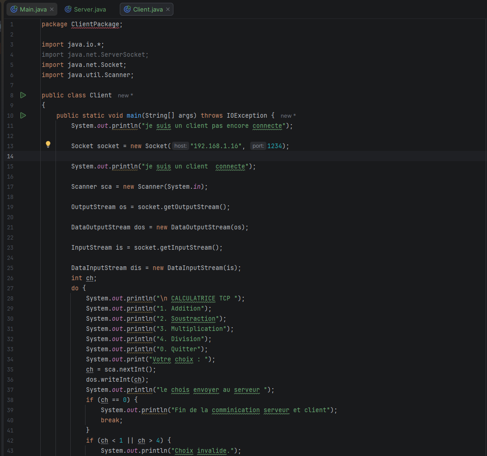
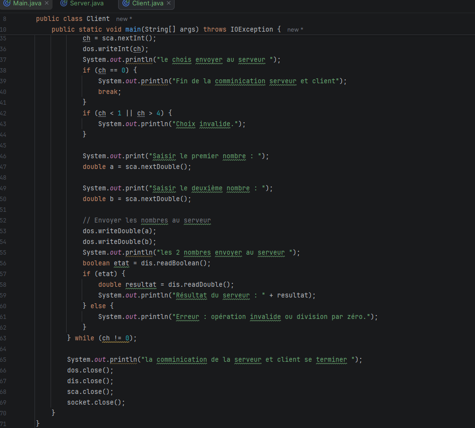
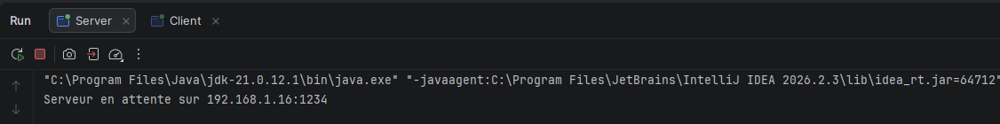
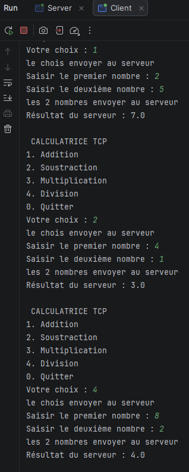

# TP1 — DAR 2026 : Communication Client-Serveur en Java

## 1. Présentation du projet

Établir une communication entre un client et un serveur en Java à l'aide des sockets TCP.

Le serveur attend les connexions entrantes, tandis que le client tente de se connecter au serveur en utilisant une adresse IP et un numéro de port.

## 2. Technologies utilisées

- **Langage :** Java
- **Version :** JDK 21
- **IDE :** IntelliJ IDEA
- **Communication réseau :** Sockets Java

## 3. Structure du projet

- `Server.java` : création et exécution du serveur.
- `Client.java` : création du client et tentative de connexion au serveur.

## 4. Exécution du programme

### Lancement du serveur

Le serveur est exécuté en premier. Il écoute les connexions entrantes sur l'adresse IP et le port configurés dans le programme.

**Capture d'écran :** lancement du serveur.

### Lancement du client

Après le démarrage du serveur, le client est exécuté afin d'établir une connexion avec celui-ci.

**Capture d'écran :** lancement du client.

## 5. Captures d'écran

Les captures d'écran présentant le code source et les résultats d'exécution seront ajoutées dans cette section.

### Code source du serveur

### Code source du client

### Résultat d'exécution du serveur

### Résultat d'exécution du client

## 6. Conclusion

Ce TP permet de comprendre les bases de la communication client-serveur en Java

Activité 1-2 : Service de calculatrice

Objectif
Établir une communication entre un client et un serveur en Java à l'aide des sockets TCP afin de réaliser un calcul côté serveur et de renvoyer le résultat au client.

Application serveur
La classe Server, située dans le package serverPackage, attend la connexion d'un client sur le port 1234.

Après la connexion, le serveur reçoit un nombre entier envoyé par le client à l'aide de DataInputStream. Il multiplie ce nombre par 5, puis renvoie le résultat au client avec DataOutputStream.

Application client
La classe Client, située dans le package ClientPackage, se connecte au serveur à l'aide d'une socket TCP sur localhost et le port 1234.

Le client demande à l'utilisateur de saisir un nombre entier, l'envoie au serveur, puis reçoit et affiche le résultat du calcul effectué par le serveur.
serveur:

Resultat:

CLIENT:

Resultat:

Conclusion
Cette activité m'a permis de comprendre comment échanger des données entre un client et un serveur en Java à l'aide des sockets TCP. J'ai appris à envoyer un nombre entier du client vers le serveur, à effectuer un calcul côté serveur et à transmettre le résultat au client.

# Activité 1-3 : Extension des fonctionnalités du service de calculatrice

## Objectif

Le but de cette activité est de faire évoluer l'application Client/Serveur réalisée dans l'activité précédente en s'appuyant sur le protocole TCP en Java. L'application doit permettre à deux ordinateurs connectés au même réseau local de communiquer afin d'exécuter des calculs à distance.

Le service proposé prend en charge quatre opérations arithmétiques : l'addition, la soustraction, la multiplication et la division.

## Application serveur

La classe `Server`, appartenant au package `serverPackage`, assure la gestion des connexions entrantes. Elle utilise `InetAddress` et `InetSocketAddress` pour définir l'adresse réseau du serveur et le port de communication `1234`.

Grâce à `ServerSocket`, le serveur reste en attente d'une demande de connexion. Une fois le client connecté, il récupère les données transmises : l'opération sélectionnée et les deux nombres à traiter.

Le serveur réalise ensuite le calcul correspondant et transmet la réponse au client avec `DataOutputStream`. La réponse indique si l'opération peut être exécutée et contient le résultat lorsque le calcul est valide.

## Application client

La classe `Client`, placée dans le package `ClientPackage`, établit une connexion TCP avec le serveur à partir de son adresse IPv4 et du port `1234`.

Une fois la connexion établie, un menu interactif permet à l'utilisateur de sélectionner l'opération souhaitée :

- `1` : Addition
- `2` : Soustraction
- `3` : Multiplication
- `4` : Division
- `0` : Fermeture de l'application

Après avoir choisi une opération, l'utilisateur saisit les deux valeurs nécessaires. Le client transmet ces informations au serveur, attend la réponse, puis affiche le résultat reçu. Si la division par zéro est demandée ou si le choix de l'opération n'est pas reconnu, un message d'erreur est présenté à l'utilisateur.

## 1. Adaptation du code pour une communication entre deux ordinateurs

Dans cette première étape, la configuration de la connexion est modifiée pour autoriser les échanges entre deux machines différentes du même réseau local. L'adresse `localhost`, qui désigne uniquement l'ordinateur utilisé, est remplacée par l'adresse IPv4 de la machine hébergeant le serveur.

Le client peut ainsi contacter le serveur à distance, à condition que les deux ordinateurs soient connectés au même réseau et que le port `1234` soit accessible.

Configuration du serveur:

 InetAddress addressIP = InetAddress.getByName("192.168.1.16");
        int port =1234;
        ServerSocket serveur= new ServerSocket();
        serveur.bind(new InetSocketAddress(addressIP,port));

Configuration du client:

      Socket socket = new Socket("192.168.1.16", 1234);

Remarque : l'adresse 192.168.1.16 est un exemple. Elle doit correspondre à l'adresse IPv4 réelle de la machine serveur.

Partie Code :
Serveur: 

Client :

 

Les Resultats :

Conclusion
Cette activité m'a permis d'améliorer mon application Client/Serveur en Java à l'aide des sockets TCP. J'ai appris à configurer une connexion entre deux machines différentes en utilisant InetAddress et InetSocketAddress.

J'ai également appris à enrichir un service de calculatrice en permettant au client de choisir une opération, d'envoyer les données au serveur et de recevoir le résultat du calcul effectué. Enfin, j'ai compris l'importance de respecter l'ordre d'envoi et de réception des données lors d'une communication TCP.

